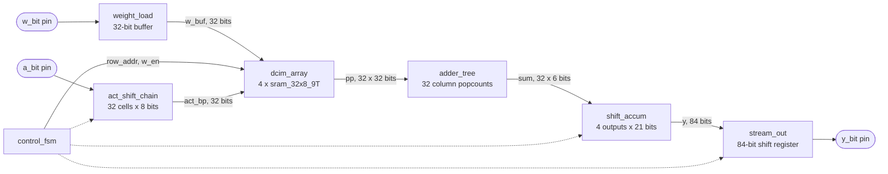
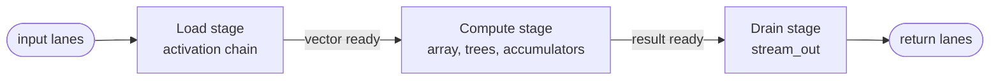
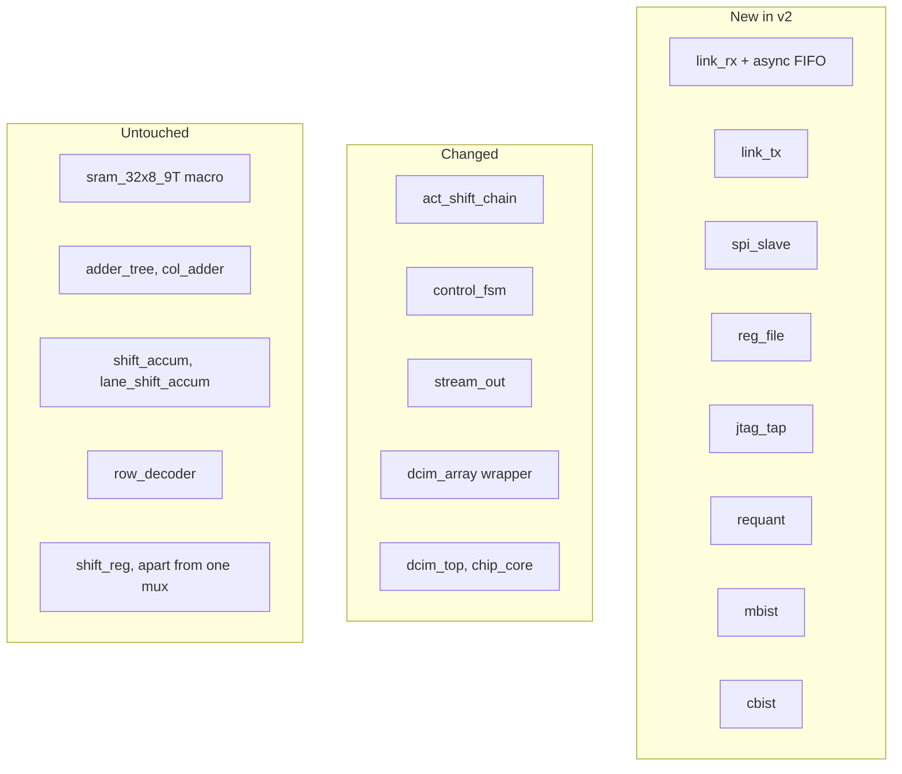

# DCIM v2: Design Guide

This document explains what each v2 change is and how it works. It starts from the v1 design as it exists in `src/` and adds one change at a time.

It does not contain RTL. It describes behavior, signals, and timing closely enough that the RTL can be written from it.

| Document | Answers |
|---|---|
| `.claude/CLAUDE.md` | What are the rules? |
| `docs/DESIGN_RATIONALE.md` | Why was each decision made? |
| `docs/V2_DESIGN_GUIDE.md` (this file) | What is each change, and how does it work? |
| `docs/V2_FLOW_AUDIT.md` | What can go wrong at each step of the flow, and what is done about it? |

## How to read the status tags

Every statement about v2 carries one of these tags.

| Tag | Meaning |
|---|---|
| **Measured** | Checked against the v1 RTL by simulation, or read from a report, netlist, or PDK file in this repository. |
| **Decided** | Agreed and recorded in `CLAUDE.md` or the rationale. |
| **Proposed** | A resolution worked out while writing this guide, not yet accepted. The nine proposals in the first draft were all accepted and are now Decided (section 9.1). Two sets remain, both in section 5.11: the SPI crossing rules and the write port rules. `docs/V2_FLOW_AUDIT.md` holds further proposed mitigations for the flow. |
| **Open** | Not decided. The guide says what depends on it. |
| **Estimate** | A v2 number. There is no v2 RTL, so no v2 number is measured. |

Section 9 lists the gaps that were closed, and every item still Open.

## One word, three meanings

"Lane" is used for three different things. This guide always says which.

| Term used here | Meaning |
|---|---|
| **Output** (0 to 3) | One of the N_WEIGHTS = 4 results. The v1 RTL calls this a lane (`lane_shift_accum`). |
| **Input lane** (0 to 3) | One of the four LINK_D pins. |
| **Return lane** (0 to 3) | One of the four LINK_TX pins. |

---

## 1. One vector through v1

Everything in this section is **Measured** on the v1 RTL.

### 1.1 The blocks

- **`weight_load`** collects 32 serial bits into `w_buf`, then pulses `wfull`.
- **`dcim_array`** holds the 32 x 32 weight bits in four macros. Its output is `pp[r][c] = weight bit [r][c] AND act_bp[r]`. It is combinational: it has no clock.
- **`act_shift_chain`** is 32 cells of 8 flops, one cell per array row. Bit 0 of each cell is that row's `act_bp`.
- **`adder_tree`** counts the ones in each of the 32 columns (0 to 32, so 6 bits each). Also combinational.
- **`shift_accum`** holds one `lane_shift_accum` per output. Each combines its 8 column counts into one signed value, then adds it into a 21-bit register, shifted left by the bit-plane index.
- **`stream_out`** captures all four results (84 bits) and shifts them out one bit per cycle.

### 1.2 The states

| State | Cycles | What happens |
|---|---|---|
| IDLE | until `start` | `busy` is low. |
| WRITE_W | 1,025 | 1,024 weight bits shift in. Every 32 bits, `wfull` pulses for one cycle and the row is written. |
| WRITE_A | 256 | 256 activation bits shift into the chain. `clr` pulses on the last cycle to zero the accumulators. |
| COMPUTE | P (8 or 1) | Each cycle: the chain presents one bit-plane, the array ANDs it, the trees count, the accumulators add. The chain then shifts so the next plane is at bit 0. |
| DONE | 1 | `done` is high. `stream_out` captures the four results. |
| SHIFT_OUT | 85 | 84 bits shift out, plus one cycle because the drain-finished flag is registered. |

Per vector: 256 + 8 + 1 + 85 = **350 cycles at P = 8**, and 256 + 1 + 1 + 85 = **343 at P = 1**. WRITE_W is paid once per weight set.

After SHIFT_OUT the state machine goes back to WRITE_A if `cont` is high (same weights, next vector), or to IDLE if not. From IDLE, `start` always goes through WRITE_W, so in v1 a new run always reloads weights.

### 1.3 Bit orders

These were confirmed by driving the pins in simulation and matching the results against an independent calculation.

- **Weights:** row 0 first. Within a row, column 0 first. Column c holds bit (c % 8) of output (c / 8)'s weight, so each weight arrives least significant bit first.
- **Activations:** the first byte streamed ends up in row 31, the last in row 0. Each byte is least significant bit first. This is because bits enter cell 0 and are pushed along the chain toward cell 31.
- **Results:** output 0 first, then 1, 2, 3. Each is 21 bits, least significant bit first, two's complement.

### 1.4 How a cell loads and computes

Each chain cell is an 8-bit register `sr[7:0]`.

- **Load:** a new bit enters at `sr[7]` and everything moves one place toward `sr[0]`. The bit leaving `sr[0]` enters the next cell's `sr[7]`.
- **Compute:** a zero enters at `sr[7]` and everything moves one place toward `sr[0]`. Nothing passes between cells.
- **`act_bp` for that row is always `sr[0]`.** It is not gated by any control signal.

### 1.5 The result is right-aligned at every precision

Each compute cycle adds `lane_val << bp_idx` into the accumulator. So after P planes the result sits in the low bits, sign-extended, whatever P is.

| Case | Result | Bits needed |
|---|---|---|
| P = 1, every weight -128, every activation bit set | -4,096 per output | fits 14 |
| P = 8, every weight -128, every activation 255 | -1,044,480 per output | fits 21 |

This matters for section 5.7.

### 1.6 What actually switches, and when

`act_bp` is wired straight from the chain to the array, and the array and adder trees are combinational. So they do not only switch during COMPUTE. They switch every time the chain shifts, which includes every cycle of WRITE_A.

Counted in simulation on the v1 RTL, random weights and activations, second vector of a run (so the memory is fully written). These are zero-delay signal transitions. They are not energy figures and they exclude glitches.

| State | Cycles | `pp` bit transitions, P = 8 | Column-sum bit transitions, P = 8 |
|---|---|---|---|
| WRITE_A | 256 | 30,916 | 10,136 |
| COMPUTE | 8 | 2,042 | 475 |
| DONE | 1 | 218 | 63 |
| SHIFT_OUT | 85 | 0 | 0 |

More than 90% of the switching in the array outputs and the adder trees happens while activations are loading, when the result is not being used. At P = 1 the share is above 99%.

The load does not switch the same amount at every precision. With `cont` held, so vectors run back to back, the same data gives 30,916 `pp` transitions per load at P = 8 and 65,647 at P = 1. A P = 8 compute shifts every row's bits out and leaves the chain empty. A P = 1 compute shifts once and leaves seven bits in every row, and the next load pushes those leftovers through every row further down the chain. After a reset the chain is empty in both cases and the load switching is identical (30,916 either way). This matters for how v1 energy is measured (section 5.16).

So "the core is idle 97% of the time" is true of useful work and false of switching. Section 5.2 is the response.

---

## 2. One vector through v2

All v2 cycle counts are **Estimates**. Their assumptions are in section 6.4.

### 2.1 Side by side, a 1-bit pass (P = 1, raw results)

| Step | v1 | v2 | What changed |
|---|---|---|---|
| Load activations | 256 | 8 (inside a 13-cycle frame) | 1-bit load mode: 32 bits, not 256. Four input lanes: 4 bits per cycle. |
| Wait for the CRC | none | 3 | Two CRC symbols, one cycle to compare. The CRC gates the start. |
| Compute | 1 | 1 | Nothing. |
| Done and capture | 1 | 1 | Nothing. |
| Drain | 85 | 22, overlapped with the next load | 14-bit results, not 21. Four return lanes, one per output. The drain no longer blocks the next vector. |
| **Per vector** | **343** | **about 22** | The drain sets the pace. The chain is only occupied for 8 + 3 + 1 = 12 cycles. |

### 2.2 Side by side, an 8-bit pass (P = 8, raw results)

| Step | v1 | v2 | What changed |
|---|---|---|---|
| Load activations | 256 | 64 (inside a 69-cycle frame) | Four input lanes. |
| Wait for the CRC | none | 3 | Two CRC symbols, one cycle to compare. |
| Compute | 8 | 8 | Nothing. |
| Done and capture | 1 | 1 | Nothing. |
| Drain | 85 | 29, overlapped | Four return lanes, one per output. |
| **Per vector** | **350** | **about 75** | The chain sets the pace: it is occupied for 64 + 3 + 8 = 75 cycles, and the next payload cannot start until it is free. |

### 2.3 The shape of the change

v1 is one state machine that does one thing at a time: load, then compute, then drain. v2 is three stages that hand a vector along, so a new vector can be loading while the previous result drains.

Each stage holds at most one item. Section 5.6 explains what happens when a stage is still busy.

---

## 3. What stays, what changes, what is new

| Module | v2 status | Why |
|---|---|---|
| `sram_32x8_9T` | Untouched | The array is the fixed baseline. |
| `adder_tree`, `col_adder` | Untouched | Compute is not the bottleneck. |
| `shift_accum`, `lane_shift_accum` | Untouched | Same arithmetic. |
| `row_decoder` | Untouched | Same write addressing. |
| `shift_reg` | One mux added | The 1-bit load mode (5.4). |
| `act_shift_chain` | Changed | Four sub-chains (5.3). |
| `dcim_array` | Changed | Generate loop (5.1), activation gating and BIST muxes at the boundary (5.2, 5.13). |
| `control_fsm` | Changed most | Load, compute, and drain become separate stages (5.6). |
| `stream_out` | Changed | Variable width, more than one return lane (5.7, 5.8). |
| `weight_load` | Replaced or reused | Weights now arrive through the register file (5.11). |
| `dcim_top`, `chip_core`, `A07_dcim_top` | Changed | New pins and wiring. |

---

## 4. Concepts primer

Short definitions of terms the rest of the guide uses.

- **Clock domain.** All the flops driven by one clock. v2 has four: core (CLK), link receive (LINK_CLK), JTAG (TCK), and SPI (SPI_SCLK).
- **Clock-domain crossing.** A signal that leaves one domain and is read in another. If it changes just as it is sampled, the receiving flop can go metastable. Every crossing needs a deliberate structure.
- **Synchronizer.** Two flops in a row in the receiving domain. Safe for a single bit that changes slowly.
- **Async FIFO.** A small memory written in one clock domain and read in another. Its read and write pointers cross in Gray code (one bit changes at a time), so a mis-sampled pointer is off by at most one. It is the standard way to move a stream of data between domains.
- **Source-synchronous.** The sender forwards its clock alongside the data. The receiver samples data on that forwarded clock, so it does not need to recover timing from the data.
- **Mesochronous.** Same frequency, unknown but fixed phase. The return lanes are mesochronous with the FPGA, because the chip's clock comes from the FPGA.
- **NRZ.** One bit per clock period, high for 1 and low for 0. Nothing is added to guarantee transitions.
- **Sync word.** A fixed pattern at the start of a frame. The receiver uses it to find where the frame begins and, on the return lanes, which sampling phase is right.
- **Frame.** One self-contained message: sync, header, payload, check.
- **CRC.** A checksum computed by a small shift register with feedback. The sender appends it and the receiver recomputes it. A mismatch means the frame was corrupted.
- **Sequence number.** A counter the sender puts in each frame. The chip copies it into the matching result, so the FPGA can tell which result answers which frame and notice a missing one.
- **Backpressure.** A later stage telling an earlier one to wait because it is still busy.
- **Shadow register.** A working copy of a configuration value, taken at a safe moment, so that a write in the middle of an operation cannot disturb that operation.
- **Operand isolation.** Holding the inputs of a combinational block steady when its output is not needed, so it does not switch for nothing.
- **March test.** A memory test that walks through every address writing and reading fixed patterns in a set order, first upward and then downward. It catches stuck cells and cells that disturb their neighbors.
- **MISR.** Multiple-input signature register. A shift register with feedback that folds a long stream of results into one short signature. If the signature matches the expected value, every result was almost certainly right.
- **TAP.** The JTAG state machine. It selects an instruction, then shifts data in and out of the register that instruction names.

---

## 5. The improvements, one at a time

They are in dependency order: each one can be built and tested on top of the ones before it. Each uses the same headings.

### 5.1 The macro array: indices from the package

**Status: Done** (2026-10-12, Karan's decision on the form). The first plan was a generate loop over the macros. It was built, it broke the flow, and the final change is much smaller.

- **Before.** `dcim_array.sv` instantiated the four macros by hand, with literal slices (`w_buf[7:0]`, `[15:8]`, and so on), a literal `rbl [3:0]`, and literal loop bounds of 4 and 8 in the read mapping.
- **Now.** The four instances stay hand-written, with their literal slices: hardcoded on purpose. The read mapping and the `rbl` declaration take their sizes straight from the package: the loop bounds are `dcim_pkg::N_WEIGHTS` and `dcim_pkg::DW`, and the mapping is `pp[r][w*dcim_pkg::DW + c] = rbl[w][r*dcim_pkg::DW + c]`, the same mapping as before. Four lines of `dcim_array.sv` changed.
- **Why not a generate loop over the instances.** A loop names the instances `MACRO[0].u_sram_32x8_9T` and so on. The flow addresses the macros by name in five files (macro placement and power connections in `config_core.yaml`, `config.yaml`, and `quadrant_workshop.yaml`; the macro power grid in `pdn_cfg.tcl` and `pdn_core_cfg.tcl`). With the new names, synthesis and macro placement passed, but power-grid generation could not find the instances under any of three spellings of the brackets (**Measured**). This applies to hard macros only: standard cells built in generate loops are not addressed by name. A text macro that stamps the instances with the v1 names was also tried and works, but was judged error prone.
- **A side effect.** Referring to `dcim_pkg::` inside a module body makes Verilator report the package's unused parameter `W_BITS`, which it had never reported while the package was used only for parameter defaults. `dcim_pkg.sv` now waives that one warning on that one line, with a comment-only pragma pair.
- **Cost.** None. The synthesized netlist of the whole core is identical to v1's, line for line, apart from source-line attributes (**Measured**, 42,332 lines).
- **Touches.** `dcim_array.sv` (four lines), `dcim_pkg.sv` (the pragma pair). Contracts 3 and 4 hold unchanged.
- **How it was checked.** `test_column_mapping_walk`, written before the change and passing unchanged after it: a single 1 in each of the 1,024 positions must appear at the same `pp` index and nowhere else, and the test asserts it ran 1,024 iterations. Nine mutations of the wiring are all caught, by that test alone as well as by the suite. Lint is clean, the 69 module tests and the 9 core-level tests pass.
- **What still guards the hardcoded instances.** The walk test and the mutation table. They are the reason the instances can safely stay hand-written while 5.2 and 5.13 add logic at the macro boundary.

### 5.2 Gate the activations at the macro boundary

**Status: Decided.** This came out of the measurement in section 1.6.

- **Today.** `act_bp` goes straight from the chain to the macros' `A` inputs. The array outputs and adder trees switch on every chain shift, including all 256 load cycles.
- **Change.** The macros' `A` input is `act_bp` only during COMPUTE, and zero otherwise.
- **How it works.** One AND gate per row, 32 in total, between the chain and the macros: `A[r] = act_bp[r] AND compute_active`. With `A` at zero every partial product is zero, so the trees see constant inputs and do not switch.
- **Worked example.** In the P = 8 measurement, 30,916 of 33,176 `pp` transitions per vector happened during WRITE_A. With gating, those do not happen. What remains is the COMPUTE switching, plus one transition into and out of zero.
- **Cost.** 32 AND gates, merged with the BIST activation multiplexer (5.13) into one structure at the macro boundary. It adds one gate delay to the compute path, which has about 20 ns of slack.
- **Drive it from a flop.** The gate's control must come straight from a register, with no logic between the flop and the gate. A control signal that glitches would let `act_bp` through for an instant and switch the trees anyway.
- **Touches.** The `dcim_array` boundary. Contract 5 (partial products active-high) and contract 6 (one bit-plane per COMPUTE cycle, rows 1:1) are unaffected: nothing changes during COMPUTE.
- **How to check.** Assert that `pp` is all zero in every cycle outside COMPUTE. Re-run the toggle count and confirm the load-time transitions are gone. All existing result checks must pass unchanged.
- **What it means for the thesis.** Without this, the energy of the compute path in v1 is mostly load-time switching, not computation. v2 shortens the load (so it switches less anyway), but gating is what makes "energy per compute cycle" mean what it says. The compute-gate configuration bit (5.16) becomes a second input to the same AND gate.

### 5.3 Four activation lanes

**Status: Decided,** including the row mapping.

- **Today.** One 256-bit chain, one input pin, 256 cycles to load.
- **Change.** The chain is cut into four sub-chains of eight rows. Each is fed by its own input lane, so four bits load per cycle.
- **How it works.** Sub-chain k holds rows 8k to 8k + 7 and is fed by input lane k. Inside a sub-chain nothing changes from v1: bits enter the lowest row's cell and are pushed toward the highest.

  | Input lane | Rows | First bit streamed lands in |
  |---|---|---|
  | 0 | 0 to 7 | row 7 |
  | 1 | 8 to 15 | row 15 |
  | 2 | 16 to 23 | row 23 |
  | 3 | 24 to 31 | row 31 |

- **Why contiguous, not interleaved.** Cutting the v1 chain at rows 8, 16, and 24 leaves every cell-to-cell connection as it is. Interleaving (lane k feeds rows k, k + 4, k + 8, ...) would rewire every connection with stride arithmetic, which is the bug pattern `CLAUDE.md` warns about. Contiguous sub-chains can also be re-joined into the single v1 chain with three multiplexers, which is how the SPI path loads (5.11). Which row holds which feature is then a software convention. It is documented once and shared by the FPGA and the training script; the chip does not know or care.
- **Cost.** Three 2:1 multiplexers at the cut points (link mode: take the lane; SPI mode: take the previous sub-chain's tail).
- **Cycles.** Full-width load: 256 / 4 = 64 cycles. **Estimate.**
- **Touches.** `act_shift_chain.sv`. Contract 6 holds: `act_bp[i]` is still row i.
- **How to check.** Load a pattern with a single 1 through each lane in turn and confirm which row and bit it lands in. Then load random data on all four lanes and compare `act_bp` plane by plane against the golden model.

### 5.4 Two load modes

**Status: Decided.**

- **Today.** Every row takes 8 bits, even at P = 1 where only bit 0 is used.
- **Change.** At P = 1 each row takes one bit. At any other P each row takes 8.
- **How it works.** In 1-bit mode a cell's `sr[0]` loads from the cell's serial input instead of from its own `sr[1]`. That is one 2:1 multiplexer per row on the `sr[0]` flop. The chain then behaves as a shift register one bit per row long. Bits `sr[7:1]` are not written and not used: at P = 1 there is exactly one compute cycle and it reads only `sr[0]`.
- **Worked example.** P = 1, four lanes. Each cycle delivers one bit to each sub-chain. After 8 cycles every one of the 32 rows has its bit. v1 took 256 cycles for the same result.
- **The mode comes from P.** There is no mode bit. P = 1 selects 1-bit load; anything else selects full width. So the two can never disagree (contract 15).
- **Cost.** 32 multiplexers.
- **Touches.** `shift_reg.sv` (the one mux), `act_shift_chain.sv`.
- **How to check.** At P = 1, load 32 known bits and confirm `act_bp` equals them. Then deliberately leave junk in `sr[7:1]` from a previous full-width load and confirm the P = 1 result is unaffected.

### 5.5 P, start, and cont move off the pins

**Status: Decided,** including "P travels with the vector".

- **Today.** `P_minus1[2:0]`, `start`, and `cont` are pins.
- **Change.** P is a register. A vector starts when a valid link frame arrives, or when the start register is written over SPI or JTAG. `cont` disappears: weights simply persist until they are written again (contract 1).
- **The gap, and the fix.** An earlier decision said P is copied into one shadow register when a vector starts. But v2 overlaps the drain with the next load, and the drain width depends on P (5.7). If P changed between two vectors, the earlier result would drain at the wrong width. So P must travel with the vector: one copy latched when the load begins and used for load mode and compute, and a second copy taken when the result is captured and used for the drain width. Two 3-bit registers.
- **In practice** P only changes together with a weight reload, when the pipeline is empty. The second copy makes the design correct even if someone gets that wrong.
- **Touches.** `control_fsm.sv`, the register file. Contract 13 (precision control stays).
- **How to check.** Run a P = 8 vector, write P = 1 while its result is still draining, start a P = 1 vector. Both results must be correct and the first must drain at 21 bits.

### 5.6 Overlapped drain, and what happens when a stage is busy

**Status: Decided,** including the overrun rule.

- **Today.** One state machine. The next load cannot begin until the drain has finished.
- **Change.** Load, compute, and drain are separate stages. A vector can load while the previous result drains.
- **How it works.** There are three places a vector or its result can sit:

  | Place | Holds | Free again when |
  |---|---|---|
  | Activation chain | a loaded vector | its compute finishes |
  | Accumulators | a finished result | `stream_out` captures it |
  | `stream_out` | a draining result | the last bit has gone |

  A result moves forward as soon as the next place is free. If `stream_out` is still draining, the finished result waits in the accumulators. That is the backpressure.
- **The gap, and the fix.** What if a new frame arrives while the chain still holds a vector that has not been computed? The chip cannot store it. The rule: **the frame is dropped and an overrun counter increments.** The FPGA then sees a gap in the returned sequence numbers and resends, exactly as it does after a CRC failure (5.10). No new mechanism and no extra pin.
- **What the FPGA must do.** Pace its frames at the per-vector period for the current mode (section 6.4). It knows P, the result width, and the number of return lanes, so it can compute the period. An overrun is then a sign of a pacing bug, not a normal event.
- **Worked example, P = 1, raw.** The chain is occupied for about 12 cycles (8 payload, 3 for the CRC, 1 compute). The drain takes 22. So after the first vector, each new result waits in the accumulators for the previous drain to finish. One vector completes every 22 cycles.
- **Worked example, P = 8, raw.** The chain is occupied for about 75 cycles (64 payload, 3 for the CRC, 8 compute). The drain takes 29 and is finished long before the next result. The next frame's sync and header can arrive while the chain is still busy, but its payload cannot. One vector completes every 75 cycles.
- **Touches.** `control_fsm.sv` (largest change in v2), `stream_out.sv`. v1 timing details 7, 8, and 9 in `CLAUDE.md` describe the single state machine and will need restating.
- **How to check.** Send frames at exactly the period: no overruns, every result correct. Send them too fast: overruns counted, every dropped frame's sequence number missing from the results, every other result correct. Check that `clr` never coincides with a compute cycle and that no result is overwritten before its last bit drains.

### 5.7 Precision-aware drain

**Status: Decided.**

- **Today.** Every result drains as 21 bits.
- **Change.** A raw result drains as DW + P + clog2(ROWS) bits: 14 at P = 1, 21 at P = 8.
- **Why it is safe.** Section 1.5: the accumulator holds the result right-aligned and sign-extended at every P, and the worst case at P = 1 fits in 14 bits.
- **How it works.** `stream_out` stops each result after the derived width. The receiver sign-extends from the last bit it received.
- **Worked example.** A P = 1 result of -291. In 14-bit two's complement that is `11 1110 1101 1101`. Sent least significant bit first: `1,0,1,1, 1,0,1,1, 0,1,1,1, 1,1`. The receiver takes the last bit (1) as the sign and extends it to get -291 again.
- **Gain.** Four results at P = 1: 84 bits become 56. **Estimate** of the effect: the drain goes from 29 cycles to 22.
- **Cost.** A width counter. No separate mode bit (contract 15).
- **Touches.** `stream_out.sv`. Contract 12 (each result least significant bit first).
- **How to check.** At each P from 1 to 8, run the worst-case negative and positive vectors and random ones, drain at the derived width, sign-extend, and compare with the golden model.

### 5.8 Return lanes

**Status: Decided,** including the result mapping.

- **Today.** One output pin, one bit per cycle.
- **Change.** Four return lanes, each sending one bit per cycle.
- **How it works.** One output per lane: return lane j carries output j, least significant bit first.

  | Return lane | 0 | 1 | 2 | 3 |
  |---|---|---|---|---|
  | Carries | output 0 | output 1 | output 2 | output 3 |

- **Why this is the simple case.** There are four outputs and four lanes, so no result is split or queued. Each lane is a short version of v1's `stream_out`: its own shift register, the same bit order, one result long.
- **Cycles for the payload.** Equal to the result width: 14 at P = 1 raw, 21 at P = 8 raw, 8 when requantized. **Estimate.**
- **Clocking.** Contract 14: the return lanes are clocked by core CLK and nothing else.
- **Cost.** Four output pads switching together on every drain cycle, through a single VDD pad and a single VSS pad. With SPI_MISO, TDO, and STATUS that is seven outputs on one supply pair, where v1 has three. The defenses are a low pad drive setting and staggering the lanes by half a cycle, both of which the per-lane sync words tolerate. See open item 2 in section 9.3.
- **Touches.** `stream_out.sv`, new `link_tx.sv`.
- **How to check.** Give each output a distinct known value and confirm which lane and which cycle each bit appears on.

### 5.9 Bias, ReLU, and requantize

**Status: Decided.** Usable on every layer of the one-pass demo candidate (section 7). In the trained demo networks the shifts are 5 to 11 and the largest bias needs 17 bits including sign (**Measured** in the model).

- **Today.** Results leave the chip as raw 21-bit sums. Anything else is done off-chip.
- **Change.** An optional stage between the accumulators and `stream_out` turns each result into an 8-bit activation for the next layer.
- **How it works,** in this order:
  1. Add a per-output bias. The add is 22 bits wide and saturating, because the largest raw sum nearly fills 21 bits.
  2. ReLU: a negative value becomes 0.
  3. Shift right by a programmable amount. The shift truncates.
  4. Saturate to 0..255.
- **Worked example,** bias 0, shift 6, using three results from the P = 8 simulation run:

  | Raw result | After ReLU | After shift by 6 | After saturation |
  |---|---|---|---|
  | 13,227 | 13,227 | 206 | 206 |
  | -4,705 | 0 | 0 | 0 |
  | -84,443 | 0 | 0 | 0 |

  A raw result of 84,443 would shift to 1,319 and saturate to 255.
- **When it must be off.** For a layer wider than 32 inputs, the chip produces partial sums that the FPGA adds together. ReLU of a partial sum is wrong, so those passes drain raw. It is also off whenever raw values are wanted, such as the final class scores.
- **Gain when on.** Four results drain as 8 bits each. **Estimate:** a 16-cycle drain.
- **Cost.** Four bias registers, a shift amount, an enable bit, four small datapaths.
- **Touches.** New `requant.sv`. Sign handling here needs explicit review: this is where a signed 21-bit value becomes an unsigned 8-bit one.
- **How to check.** Against a golden model written from the four steps above: boundary values at each step (bias overflow in both directions, exactly 0, exactly 255, one above 255), every shift amount, and random values.

### 5.10 Link receive: frames, CRC, and the FIFO

**Status: Decided** (source-synchronous, 4 lanes, frame fields, CRC gates start, sequence number, resend rules). Where the framing logic lives and the CRC bit order are also Decided. Sync pattern, CRC polynomial, FIFO depth, and the idle count are **Open**.

- **Today.** Activations arrive one bit per cycle on a pin clocked by the core clock.
- **Change.** Activations arrive four bits per cycle on LINK_D, sampled on the forwarded LINK_CLK.
- **A symbol** is the four bits sampled on one LINK_CLK edge, one from each input lane.
- **The frame,** in symbols:

  | Field | Symbols | Content |
  |---|---|---|
  | Sync | 1 | A fixed non-zero pattern. Idle is all zeros. |
  | Header | 2 | 2-bit frame type, 6-bit sequence number. |
  | Payload | 8 at P = 1, 64 otherwise | One bit per input lane per symbol, straight into the four sub-chains. |
  | CRC | 2 | CRC-8 over the header and payload. |

  Total: 13 symbols at P = 1, 69 otherwise.
- **Where the logic lives.** The LINK_CLK domain does two things only: sample the four lanes, and write every symbol into the async FIFO. Everything else (finding sync, counting, CRC, deciding to start) is in the core domain, reading symbols out of the FIFO.
  - **Why.** The frame length depends on P, which is a core-domain register. Parsing in the link domain would mean carrying P across a clock boundary. This way the link domain is four input flops and a FIFO write pointer.
  - **What it requires.** LINK_CLK must run continuously while the link is enabled, and must not be faster than core CLK, or the FIFO overflows. Both clocks come from the FPGA, so this is the FPGA's job to guarantee. It is recorded as an interface contract (contract 16 in `CLAUDE.md`).
- **CRC.** Computed over symbols in the order they arrive, four bits per cycle. The return lanes use the same definition. There the FPGA must first deskew each lane by its own sync word, and only then assemble symbols and check the CRC, because the four lanes can arrive with different delays.
- **What a valid frame does.** The payload shifts into the chain as it arrives. When the CRC symbols arrive and match, compute starts. If they do not match, compute does not start, the CRC error counter increments, and the next frame overwrites the chain. The CRC gates the start, not the load.
- **Resend.** Each result carries the sequence number of its frame (5.8, 6.2). A dropped frame produces no result. The FPGA sees the gap and sends it again. Results can therefore arrive out of order, which is safe because vectors do not depend on each other.
- **After a CRC failure** the receiver ignores input until it has seen N idle symbols in a row, so it cannot mistake payload data for a sync. N is at least one full frame (69 symbols). **Open:** the exact value.
- **Unplugged module.** LINK_CLK and LINK_D have their pad pull-downs enabled. With nothing connected the lanes read as idle and the link clock does not toggle.
- **Touches.** New `link_rx.sv` with the async FIFO.
- **How to check.** Good frames; a frame with each single bit flipped in turn (every one must be rejected); a frame cut short; back-to-back frames; LINK_CLK at several phases relative to CLK; LINK_CLK slower than CLK. The FIFO needs its own test with the two clocks unrelated.

### 5.11 SPI and the register file

**Status: Decided,** including the burst weight write, the SPI activation path, the busy rule, and SPI being clocked by its own clock. The crossing rules are **Proposed**.

- **Today.** No registers. Every control is a pin.
- **Change.** A register file holds all configuration and status. SPI reads and writes it.
- **How SPI is clocked.** SPI_SCLK is a real clock. The SPI shift register and bit counter are flops clocked by it, in their own clock domain, the fourth in v2. An earlier decision had the core clock sample SCLK instead, which saved a domain but capped SCLK at a quarter of the core clock. That made every weight reload four times slower than v1's, and v2 slower than v1 for a single image. Clocking SPI directly removes the cap.
- **Why speed up SPI and not the link.** SPI does not pass through the link module, so it works the same whether a photonic, copper, or wire module is fitted (section 9.4).
- **The crossing (Proposed).** SCLK only toggles during a transaction, so the SPI domain cannot be relied on to finish anything after the last bit. Three rules follow:
  - Whole words cross, never single bits. When a word is complete in the SPI domain (a 32-bit row for weights, a byte for everything else), a flag toggles and the core clock picks the word up. The core does the rest on its own clock.
  - SCLK is never faster than core CLK. The core needs 8 of its own cycles to shift an activation byte into the chain, and a new byte arrives every 8 SCLK cycles.
  - CS_N high resets the SPI bit counter, so a transaction cut short cannot leave it misaligned. Reads carry one dummy byte between the address and the data, which gives the value time to cross from the core into the SPI domain.
- **Weights.** One command followed by all 1,024 bits, row 0 first, in the v1 bit order. Each time 32 bits have arrived the row crosses to the core, which writes it and moves to the next row by itself. With SCLK at the core clock rate that is at least 1,024 core cycles for a weight set, essentially v1's 1,025. If SCLK runs at 1/k of the core rate, it is 1,024 x k.
- **The write port (Proposed).** Three things can now write the array: SPI, JTAG through the same register file, and memory BIST. In the v1 netlist the wordlines come from combinational logic fed by the row counter and the write enable, which change on the same clock edge, and the macro's write is level-sensitive. A decoder can then pulse the wrong wordline for an instant while its inputs settle. Whether v1 actually does is not known; nothing in the flow checks it. v2 removes the question with four rules:
  - One write controller owns the write port. Everything else asks it to write.
  - The wordline enable comes straight from a flop.
  - The row address and the bitline data are stable for the cycle before, the cycle of, and the cycle after the enable. A row write therefore takes three cycles, not one. That costs nothing on a weight load, where a new row only arrives every 32 cycles. It triples the write steps of memory BIST, which is still only a few thousand cycles.
  - The activation input is zero during every write. The gate in 5.2 already ensures this as long as writes only happen when idle.
- **Activations over SPI.** In SPI mode the three multiplexers from 5.3 re-join the four sub-chains into one chain. Each byte that arrives crosses to the core, which shifts it into the chain one bit per core cycle, in the same order as v1's `a_bit` pin. Then a write to the start register runs the vector.
- **Results over SPI.** The four raw results are readable registers. So the chip is fully usable with the link unplugged.
- **Writes while busy.** Weights, P, bias, and shift may only be written when the status register reads idle. A write at any other time is ignored and sets an error flag. This is the simplest rule that cannot corrupt a vector in flight.
- **Touches.** New `spi_slave.sv`, `reg_file.sv`. `weight_load.sv` is either reused behind the register file or replaced.
- **How to check.** A bus driver in `cocotb/bfm/`. Write then read back every register. Load weights and activations over SPI only, run a vector, read the results, compare with the golden model. Then attempt each forbidden write while busy. Because SCLK is now its own clock, run all of it with SCLK at several phases and rates relative to CLK, including a transaction cut short by raising CS_N mid-word.

### 5.12 JTAG with DEBUG access

**Status: Decided.**

- **Today.** No test access.
- **Change.** A JTAG TAP with five instructions.

  | Instruction | Does |
  |---|---|
  | BYPASS | One-bit pass-through. Required by the standard. |
  | IDCODE | Shifts out a fixed 32-bit identity. Proves the chip is alive. |
  | DEBUG | Reads or writes one register in the same register file SPI uses. |
  | MBIST | Runs memory BIST and returns its result. |
  | CBIST | Runs compute BIST and returns its result. |

- **How DEBUG works.** The shifted-in word carries a read or write flag, a register address, and data. When the TAP reaches its update state the request is handed to the core domain through a handshake, because TCK and CLK are unrelated. A read takes two scans: one to ask, one to collect.
- **What does and does not need the core clock.** BYPASS and IDCODE live entirely in the TCK domain and answer even if CLK is dead. DEBUG, MBIST, and CBIST need CLK.
- **No TRST pin.** Holding TMS high for five TCK cycles resets the TAP. TMS has its pad pull-up enabled, so an unconnected TAP resets itself.
- **Touches.** New `jtag_tap.sv`, plus a second port on `reg_file.sv`.
- **How to check.** A JTAG driver in `cocotb/bfm/`. IDCODE with CLK stopped. Every register through DEBUG. A full vector run over JTAG alone. SPI and JTAG writing at the same time.

### 5.13 Memory BIST through the compute port

**Status: Decided.**

- **Today.** The only way to learn whether a cell works is to run a computation and see if the answer is right.
- **Change.** A built-in march test over all 32 rows.
- **The problem.** The macro has no read port. Its only output is `stored bit AND A`.
- **How it reads.** Set `A` to one-hot, with only row r high. Then every partial product in every other row is 0, and each column's popcount equals row r's bit in that column. The 32 column sums, each 0 or 1, are row r's 32 bits. No new read path is needed.
- **What it needs at the macro boundary.** A multiplexer so BIST can drive `A` (shared with the gate from 5.2), and one so it can drive the row address and write data.
- **What it tests.** Storage, the AND compute port, and the adder trees. A tree fault and a cell fault look the same from here; compute BIST and register readback tell them apart.
- **What it reports.** Pass or fail, and the first failing row.
- **A caution.** Contract 4 says the read mapping between the RTL and the physical macro ports is not yet verified. If that mapping is wrong in silicon, memory BIST will report a failure even though every cell works. That is useful information, not a false alarm, but it is why BIST must never block normal operation.
- **Touches.** New `mbist.sv`, the `dcim_array` boundary.
- **How to check.** Inject each fault type into the macro model (a cell stuck at 0, stuck at 1, two cells coupled) and confirm the right row is reported. Confirm a clean model passes. Assert the iteration count covers all 32 rows in both directions.

### 5.14 Compute BIST

**Status: Decided.**

- **Change.** The chip loads fixed weights and activations, runs a series of vectors, and folds every result into a MISR. The final signature is compared with a constant.
- **What it tests.** Chain, array, trees, output combine, accumulators, together.
- **Where the expected signature comes from.** The golden model, run on the same fixed patterns and fed through a model of the MISR. It must not come from simulating the RTL, or a bug in the RTL would be baked into the expected value.
- **Touches.** New `cbist.sv`.
- **How to check.** The signature from the RTL must equal the signature from the golden model. Then inject a single wrong result bit and confirm the signature changes.

### 5.15 Self-test at reset, and the STATUS pin

**Status: Decided.**

- **Sequence.** Out of reset both BISTs run by themselves.
- **Rules that keep them harmless.**
  - They never block normal operation.
  - The first write over SPI or JTAG, or the first valid link frame, aborts a running BIST. Reads do not.
  - A timeout aborts a BIST that hangs and releases the macro-boundary multiplexers.
- **Status field,** readable over SPI and JTAG: running, pass, fail, aborted.
- **STATUS pin before the first write or valid frame:**

  | Pin | Meaning |
  |---|---|
  | Low | Self-test running. |
  | Slow square wave | Passed. |
  | Held high | Failed, or aborted by the timeout. |

- **STATUS pin afterwards.** It becomes DONE: one pulse each time a compute finishes. The square wave stops, so it cannot disturb an energy measurement.
- **Why a square wave.** A stuck pad can hold a level but cannot toggle, so a pass cannot be faked by a fault.

### 5.16 Hooks for the energy measurement

**Status: Decided.** The method itself is in the rationale.

| Config bit | Effect | Used for |
|---|---|---|
| Compute-gate | The identical sequence runs, but `A` stays at zero during compute. | Compute energy = normal run minus gated run. |
| Return-lane silence | The return lanes do not toggle. | Removes pad driver energy, which is on the same supply as the core. |
| Activation source | SPI or link. | Stating which interface a number was measured on. |

With 5.2 in place, the compute-gate bit is simply a second condition on the same 32 AND gates.

**v1 has none of these hooks,** so its compute energy is found by comparing a P = 1 run with a P = 8 run on the same data. Section 1.6 shows the catch: with `cont` held, the two loads do not switch the same amount, and the difference (about 34,700 `pp` transitions) is far larger than the compute difference being measured (about 1,800). **Measured:** with a reset before each run the two loads are identical and the remaining difference is the compute. So on v1 each measured run starts from reset. The rationale has the full method.

---

## 6. The pieces together

### 6.1 Inbound frame, symbol by symbol (P = 1)

| Symbol | 0 | 1 | 2 | 3 to 10 | 11 | 12 |
|---|---|---|---|---|---|---|
| Field | Sync | Header | Header | Payload | CRC | CRC |

Payload symbol s (0 to 7), under the mapping proposed in 5.3: input lane k's bit lands in row 8k + 7 - s.

### 6.2 Return frame, per lane

| Field | Bits on each of the four lanes |
|---|---|
| Sync word | 4 |
| Sequence number (6 bits spread across the lanes, 2 bits spare) | 2 |
| Payload | 1 x result width |
| CRC-8 (spread across the lanes) | 2 |
| **Overhead** | **8** |

So a return frame takes 8 + width cycles: 22 at 14 bits, 29 at 21 bits, 16 when requantized.

The 4-bit sync word length is an assumption. **Open.**

### 6.3 What the register file must hold

This is a list of contents, not a map. Addresses and field layout are **Open**.

| Group | Contents |
|---|---|
| Weights | Burst write of 1,024 bits. Row readback through the compute port. |
| Precision | P. |
| Requantize | Enable, four biases, shift amount. |
| Mode | Activation source, compute-gate, return-lane silence, link enable. |
| Control | Start. |
| Status | Idle or busy, BIST state (four values), write-while-busy error flag. |
| Counters | CRC errors, overruns. |
| Results | Four raw results. |
| Self-test | First failing row, compute BIST signature. |

### 6.4 Estimated cycles per vector

**Estimate.** Assumptions, all to be verified:

- The lane rate equals the core clock.
- Frame overheads as in 6.1 and 6.2.
- One cycle for done and capture. It does not hold the chain.
- The CRC comparison is registered, so compute starts one cycle after the last CRC symbol.
- The activation chain is occupied from the first payload symbol until compute ends: payload + 2 CRC symbols + 1 compare + compute. The next payload cannot start until then. There are no ping-pong banks.
- The FIFO crossing adds latency (about 3 cycles) but no steady-state cost.

| Mode | Inbound frame | Chain occupied | Drain | Per vector | v1 | Speedup |
|---|---|---|---|---|---|---|
| P = 1, raw (14-bit) | 13 | 12 | 22 | 22 | 343 | about 16x |
| P = 1, requantized | 13 | 12 | 16 | 16 | 343 | about 21x |
| P = 8, raw (21-bit) | 69 | 75 | 29 | 75 | 350 | about 4.7x |
| P = 8, requantized | 69 | 75 | 16 | 75 | 350 | about 4.7x |

The per-vector figure is the largest of the three, because the stages overlap. At P = 1 the drain sets it. At P = 8 the chain does.

How each column is built:

| Column | P = 1 | P = 8 |
|---|---|---|
| Inbound frame | 1 sync + 2 header + 8 payload + 2 CRC = 13 | 1 + 2 + 64 + 2 = 69 |
| Chain occupied | 8 payload + 2 CRC + 1 compare + 1 compute = 12 | 64 + 2 + 1 + 8 = 75 |
| Drain, raw | 4 sync + 2 sequence + 14 payload + 2 CRC = 22 | 4 + 2 + 21 + 2 = 29 |
| Drain, requantized | 4 + 2 + 8 + 2 = 16 | 4 + 2 + 8 + 2 = 16 |

### 6.5 Pins

| v1 pin | v2 |
|---|---|
| `clk`, `rst_n` | CLK, RST_N |
| `a_bit` | LINK_D[3:0] with LINK_CLK, or SPI |
| `w_bit` | SPI (register file) |
| `start`, `cont` | register write, or a valid link frame |
| `P_minus1[2:0]` | register |
| `y_bit` | LINK_TX, or SPI readback |
| `done`, `busy` | STATUS pin, status register |
| VDD, VSS | VDD, VSS |
| | new: SPI x 4, JTAG x 4 |

| Group | Pins | Count |
|---|---|---|
| Supply | VDD, VSS | 2 |
| Clock and reset | CLK, RST_N | 2 |
| SPI | SPI_SCLK, SPI_CS_N, SPI_MOSI (in), SPI_MISO (out) | 4 |
| JTAG | TCK, TMS, TDI (in), TDO (out) | 4 |
| Link in | LINK_CLK, LINK_D[3:0] | 5 |
| Link out | LINK_TX[3:0] | 4 |
| Status | STATUS | 1 |
| **Total** | 2 supply, 13 inputs, 7 outputs | **22** |

If the pad count rises above 22, the first extra pads go to a second VDD, then a second VSS, subject to the organizers allowing two pads on one supply net (section 9.3). If pins must be cut, the order is: return lanes from four to two, then STATUS, then input lanes from four to two.

### 6.6 From reset to the first result

1. RST_N is released. Each clock domain comes out of reset on its own clock.
2. Both BISTs run. STATUS is low.
3. STATUS shows the result: square wave for pass, high for fail.
4. The FPGA writes the weight set, P, and any requantize settings over SPI. The first write switches STATUS to DONE mode.
5. The FPGA sends activation frames on the link, paced at the per-vector period.
6. For each frame: the payload loads, the CRC is checked, compute runs, the result is captured and drains on the return lanes with the frame's sequence number.
7. To change weights: wait for idle, write the new set, continue.

---

## 7. The demo network, end to end

**Status: Decided** (Karan, 2026-10-09). The demo is photograph recognition, trained on the Imagenette dataset, run two ways on the same chip: a self-attention network as the headline and a convolution-only network as the reference. The chip is identical for both. Only the weights and the FPGA's schedule differ.

The task is colour photographs in ten classes. Imagenette is ten classes taken from ImageNet (fish, dog, cassette player, chain saw, church, French horn, garbage truck, gas pump, golf ball, parachute): 9,469 training photographs and 3,925 validation photographs. Each photograph is shrunk to 64 x 64 before it enters the network. The network is convolutional. It is trained and checked with the system model in `model/` (section 7.4).

The earlier demo dataset was CIFAR-10 (32 x 32 photographs). Its results are kept where nothing newer exists (7.2, 7.5, 7.7) and are labelled as such.

### 7.1 The building blocks, and how each fits one weight set

One window of one image is one vector. A weight set is loaded once, and every window of every image in the batch goes through it before the next set is loaded.

| Layer type | What it computes | Inputs per output | How it fits 32 rows by 4 outputs |
|---|---|---|---|
| 3 x 3 convolution on the image | Each output looks at a 3 x 3 window of all three colours | 27 | One pass per 4 outputs |
| Depthwise 3 x 3 convolution | Each feature map is filtered on its own | 9 | Three maps share one weight set: map j uses rows 9j to 9j + 8 and output j, with zero weights elsewhere |
| 1 x 1 convolution | Mixes the feature maps at one position | The number of maps | One pass per 4 outputs with 32 maps or fewer; chunked above that |
| 2 x 2 max pooling, global maximum | Keeps the largest value | none | Not on the chip: compares on the FPGA |
| Final layer | One score per class | The number of maps | 3 passes for 10 classes at 32 maps |

### 7.2 The demo networks and the alternatives

**Decided:** the two demo networks. Mean of three training runs; "independent" is the 458 photographs described below. Full figures for the attention network are in 7.7.

| Role | Network | Validation | Independent | Chip passes | Weight sets: loaded once, written per image |
|---|---|---|---|---|---|
| Headline | One-pass front end, then 3 attention blocks | 82.0% | 70.8% | 35,907 | 131, 76 |
| Reference | One-pass, convolution only | 81.2% | 71.7% | 30,899 | 116, 0 |

The two share their first seven layers (down to the 8 x 8 map). From there the reference continues with depthwise and 1 x 1 convolutions, and the headline network with attention blocks:

| # | Layer of the attention network | Output size | Inputs per output | Weight sets | Passes |
|---|---|---|---|---|---|
| 1 to 7 | As the one-pass network below (rows 1 to 7) | 16 x 16 x 32 | | 56 | 28,160 |
| | 2 x 2 max pooling (FPGA) | 8 x 8 x 32 | | | |
| 8, 10 | Attention block, twice: query, key, value | 8 x 8, 64 positions | 32 | 16 each | 1,024 each |
| | scores (this image's keys as weights) | 64 x 64 | 16 | 16 per image, each | 1,024 each |
| | mixing (this image's values as weights) | 8 x 8 x 32 | 64 | 16 per image, each | 1,024 each |
| 9, 11 | 1 x 1 convolution, twice | 8 x 8 x 32 | 32 | 8 each | 512 each |
| | 2 x 2 max pooling (FPGA) | 4 x 4 x 32 | | | |
| 12 | Attention block: query, key, value | 4 x 4, 16 positions | 32 | 16 | 256 |
| | scores and mixing | | 16 | 12 per image | 192 |
| 13 | 1 x 1 convolution | 4 x 4 x 32 | 32 | 8 | 128 |
| | Global maximum (FPGA) | 32 values | | | |
| 14 | Final layer | 10 scores | 32 | 3 | 3 |
| | **Total** | | | **131, and 76 per image** | **35,907** |

Four things the attention network asks of the FPGA that the reference does not: a bias that differs for every position on queries and keys (the position term), a signed limit on keys and values (they become weights), adding the block's input back after mixing, and adding the two partial sums of the mixing step on the 8 x 8 map (64 inputs, 4,096 adds per image). On-chip requantize (5.9) has one bias per output, held for the whole batch, so it covers the convolution layers and the attention score step (which has a single bias); the query, key, value, and mixing steps use the raw drain. At P = 8 a raw drain costs no cycles (7.3).

The rest of this section is the wider set of networks that was measured on the way. The wide and full-resolution networks were not chosen: their gain on the validation photographs does not show on independent ones.

**Measured** in the model on Imagenette at 64 x 64: integer arithmetic, accuracy on the 3,925 validation photographs, which are never trained on. Passes are per image.

| | One-pass | Wide | One-pass at full resolution |
|---|---|---|---|
| First layer | 3 x 3 convolution moving 2 pixels (64 x 64 to 32 x 32) | The same | 3 x 3 convolution moving 1 pixel, then one more pooling stage |
| Feature maps | 16, then 32 throughout | 32, then 64, then 128 | 16, then 32 throughout |
| Layers on the chip | 14 | 14 | 18 |
| Weights | 7,968 | 70,528 | 10,592 |
| Weight sets | 116 | 700 | 154 |
| Chip passes | 30,899 | 96,316 | 125,107 |
| Layers that need chunking | none | five 1 x 1 layers (64 or 128 inputs) and the final layer | none |
| FPGA partial-sum adds | 0 | 104,478 | 0 |
| Accuracy | 81.7%, mean of three runs (81.3 to 82.0) | 84.2%, one run | 84.6%, one run |

- **Run-to-run spread.** Three training runs of the one-pass network span 0.7 points. Treat differences between single runs of under about 1.5 points as not meaningful.
- **Image size matters more than network width.** The one-pass network on 32 x 32 input scored 76.7% (one run), about 5 points below the same network on 64 x 64.
- **Integer against floating point.** On every network trained with 8-bit activations and weights, integer accuracy was within 0.4 points of floating point.
- **Photographs from other sources.** One saved network per candidate (not a mean of runs) was tested on two sets it never trained on. ImageNetV2 is an independent test set collected years later by other people; 208 of its photographs are of the ten classes, and none of them is in Imagenette. The web set is 250 photographs from Wikimedia Commons topic categories, 25 per class, taken as they come.

| Imagenette networks, one network each | One-pass | Wide | One-pass at full resolution |
|---|---|---|---|
| Validation photographs (3,925) | 81.3% | 84.2% | 84.6% |
| ImageNetV2 (208) | 77.4% | 80.8% | 79.3% |
| Web photographs (250) | 70.0% | 66.4% | 70.4% |
| Both independent sets (458) | 73.4% | 72.9% | 74.5% |

With 458 photographs the uncertainty is about 2 points. So the three candidates are not separated on independent photographs: the 3-point gain the two larger networks show on the validation photographs does not show there.

The one-pass and wide shapes were first trained on CIFAR-10, with a larger drop on other data:

| CIFAR-10 networks (earlier dataset), one run each | One-pass | Wide |
|---|---|---|
| 10,000 held-out images | 83.7% | 91.0% |
| Independent dataset (CIFAR-10.1, 2,000 images) | 72.5% | 81.7% |
| 100 photographs from the web | 58% | 58% |

The one-pass candidate, layer by layer:

| # | Layer | Output size | Inputs per output | Weight sets | Passes |
|---|---|---|---|---|---|
| 1 | 3 x 3 convolution, moving 2 pixels (input 64 x 64 x 3) | 32 x 32 x 16 | 27 | 4 | 4,096 |
| 2 | Depthwise 3 x 3 | 32 x 32 x 16 | 9 | 6 | 6,144 |
| 3 | 1 x 1 convolution | 32 x 32 x 32 | 16 | 8 | 8,192 |
| | 2 x 2 max pooling (FPGA) | 16 x 16 x 32 | | | |
| 4, 6 | Depthwise 3 x 3, twice | 16 x 16 x 32 | 9 | 11 each | 2,816 each |
| 5, 7 | 1 x 1 convolution, twice | 16 x 16 x 32 | 32 | 8 each | 2,048 each |
| | 2 x 2 max pooling (FPGA) | 8 x 8 x 32 | | | |
| 8, 10 | Depthwise 3 x 3, twice | 8 x 8 x 32 | 9 | 11 each | 704 each |
| 9, 11 | 1 x 1 convolution, twice | 8 x 8 x 32 | 32 | 8 each | 512 each |
| | 2 x 2 max pooling (FPGA) | 4 x 4 x 32 | | | |
| 12 | Depthwise 3 x 3 | 4 x 4 x 32 | 9 | 11 | 176 |
| 13 | 1 x 1 convolution | 4 x 4 x 32 | 32 | 8 | 128 |
| | Global maximum (FPGA) | 32 values | | | |
| 14 | Final layer | 10 scores | 32 | 3 | 3 |
| | **Total** | | | **116** | **30,899** |

The first three layers run on the 32 x 32 map and are 60% of the passes.

### 7.3 Estimated cycles

Every pass is 8-bit, so the per-vector periods are 350 (v1, **Measured**) and 75 (v2, **Estimate**). Weight sets cost 1,025 (v1) and at least 1,024 (v2, with SCLK at the core clock rate).

| | One-pass | Wide | One-pass at full resolution |
|---|---|---|---|
| v1, passes | 30,899 x 350 = 10,814,650 | 96,316 x 350 = 33,710,600 | 125,107 x 350 = 43,787,450 |
| v2, passes | 30,899 x 75 = 2,317,425 | 96,316 x 75 = 7,223,700 | 125,107 x 75 = 9,383,025 |
| v1, weight reloads | 116 x 1,025 = 118,900 | 700 x 1,025 = 717,500 | 154 x 1,025 = 157,850 |
| v2, weight reloads | 116 x 1,024 = 118,784 | 700 x 1,024 = 716,800 | 154 x 1,024 = 157,696 |
| v1 total, one image | 10,933,550 (about 437 ms at 25 MHz) | 34,428,100 (about 1.38 s) | 43,945,300 (about 1.76 s) |
| v2 total, one image | 2,436,209 (about 97 ms) | 7,940,500 (about 318 ms) | 9,540,721 (about 382 ms) |
| Reload share of v2, one image | about 5% | about 9% | about 2% |
| Speedup, one image | about 4.5x | about 4.3x | about 4.6x |

With a batch, reloads are shared and the speedup approaches the per-pass figure of about 4.7x.

The headline attention network, by the same rules: 35,907 passes x 75 = 2,693,025 cycles, plus 76 weight sets written per image x 1,024 = 77,824, plus 131 loaded once x 1,024 = 134,144. That is 2,904,993 cycles for one image (about 116 ms at 25 MHz). v1 would need 35,907 x 350 + 207 x 1,025 = 12,779,625 (about 511 ms), so about 4.4x. The per-image writes are about 3% of the image's cycles, and a batch does not share them.

Two things to say plainly:

- **The headline is about 4.5x, not 9.5x.** The 9.5x figure belongs to the bring-up network (7.6), most of whose passes are 1-bit. Lower precision does not recover it as the design stands: v2 loads the full 8 bits per row at every precision except P = 1 (5.4), so a 4-bit pass is 64 + 2 + 1 + 4 = 71 cycles, hardly better than 75. Only a 1-bit pass (22 cycles) is much cheaper. A load of only P bits per row would make a 4-bit pass 32 + 2 + 1 + 4 = 39 cycles, but in the model 4-bit pixels and activations cost about 3 points on held-out images and 5 on an independent dataset (7.7). That would change the decision in 5.4 and is not proposed here.
- **Requantize does not speed up an 8-bit pass.** The activation chain bounds the period at 75 cycles whether the drain is 29 cycles (raw) or 16 (requantized). Its value here is moving bias, ReLU, and scaling off the FPGA.

### 7.4 The system model

`model/` holds a Python model of the whole chain, one package per stage. It is how the candidates above were found.

| Package | Role |
|---|---|
| `model/ml_model/` | Datasets, training, and the network as integers. `network.py` defines the exact math the hardware must do. |
| `model/fpga/` | Cuts layers into weight sets, runs the batch, counts the arithmetic left to the FPGA. |
| `model/digital_dcim/` | The chip's arithmetic, bit for bit, from the contracts in `CLAUDE.md`, and the cycle estimates of 6.4. |
| `model/emulation.py` | Runs a trained network through every stage and compares the chip's scores with the plain integer math. |

- **What is checked.** The chip model equals W^T a for P = 1 to 8 and agrees with `cocotb/golden/lane_shift_accum.py`. Each trained network checked through `emulation.py` gave identical scores from the chip model and the plain integer math.
- **What it does not model.** Frames, CRC, clock domains, timing, and the RTL. The FPGA does bias, ReLU, and scaling in the model; on-chip requantize gives the same integers but is not modelled there yet.
- **How to run it.** Training needs PyTorch: `/usr/bin/python3 -m model.ml_model train --dataset imagenette --size 64 --crop-from-source --bn --arch "<shape>"`. Then `python3 -m model.ml_model show`, `predict --image <file>`, `test --folder <directory with one folder per class>`, and `python3 -m model.emulation --net <file>`. Network shapes are one line of text, described in `model/ml_model/arch.py`.

### 7.5 The optical first layer as a variant

**Measured** in the model, under ideal optics with 8-bit weight resolution, with the same network behind the first layer (three convolution and pooling stages), integer accuracy on held-out CIFAR-10 images (the earlier dataset; not repeated on Imagenette):

| First layer | Kernels | Weights | Output | Accuracy |
|---|---|---|---|---|
| On the chip (reference) | 16 | signed | 8-bit | 83.2% |
| Optical, nothing restricted | 16 | signed | 8-bit | 83.6% |
| Optical, non-negative weights | 16 | non-negative | 8-bit | 78.8% |
| Optical, 1-bit output | 16 | signed | 1-bit | 78.1% |
| Optical, 4 kernels | 4 | signed | 8-bit | 79.2% |
| Optical, non-negative and 1-bit | 16 | non-negative | 1-bit | 71.3% |
| Optical, all three restrictions | 4 | non-negative | 1-bit | 64.5% |
| As the rationale describes it (2 x 2 patches) | 4 | non-negative | 1-bit | 67.1% |
| The same with 16 kernels | 16 | non-negative | 1-bit | 74.0% |

Each restriction costs about 4 to 5 points, and together they cost about 16.

**Measured** on Imagenette at 64 x 64, with the attention candidate of 7.7 behind the first layer (heavy front end, 3 attention blocks). The optical layer replaces that network's first convolution: a 3 x 3 window moving 2 pixels, 16 kernels unless stated. Integer accuracy, mean of three training runs, ideal optics with 8-bit weight resolution. "Independent" is the 458 photographs of 7.2. Cycles are the v2 **Estimate** per image, as in 7.7.

| First layer | Weights | Output | Validation | Independent | Cycles per image |
|---|---|---|---|---|---|
| On the chip (reference) | signed | 8-bit | 82.0% | 70.8% | 2,770,849 |
| Optical, nothing restricted | signed | 8-bit | 81.3% | 71.1% | 2,463,649 |
| Optical, non-negative weights | non-negative | 8-bit | 80.5% | 69.8% | 2,463,649 |
| Optical, 1-bit output | signed | 1-bit | 78.5% | 66.9% | 2,138,017 |
| Optical, both restrictions | non-negative | 1-bit | 72.9% | 63.5% | 2,138,017 |
| The same with 4 kernels | non-negative | 1-bit | 68.6% | 55.7% | 2,047,905 |

- **An unrestricted optical first layer matches the chip** and saves about 11% of the cycles, because that layer then costs the chip nothing.
- **Non-negative weights alone cost about 1.5 points** when the output is 8-bit.
- **The 1-bit output costs about 3.5 points.** It also makes the next layer's passes 1-bit, which is where the further cycle saving comes from.
- **Both together cost about 9 points, and 13 to 15 with only 4 kernels.**

So the restriction worth removing first is the 1-bit output (a converter in place of the comparator), not the sign of the weights. A second layout, a 4 x 4 patch layer seen once per patch, was far more sensitive: both restrictions together cost 23 points there. The candidates in 7.2 keep every layer on the chip, and the optical first layer is run as a variant of them (open item 14).

### 7.6 The bring-up network

The earlier demo is kept as a small first test. It is the case that exercises the 1-bit load mode and the precision-aware drain.

The network: 8 x 8 binarized digits, 2 x 2 patches at stride 2 (16 patches), 4 kernels, so 64 binary features. Then 16 hidden units. Then 10 classes.

| Layer | Shape | P | Pieces | Weight sets | Drain |
|---|---|---|---|---|---|
| 1 | 64 to 16 | 1 | 2 input chunks of 32, times 4 groups of 4 outputs | 8 | Raw, 14-bit. Chunked, so the FPGA adds the two partial sums, then applies bias and ReLU. |
| 2 | 16 to 10 | 8 | 1 input chunk (16 rows used, 16 padded with zero), times 3 groups of outputs | 3 | Raw, 21-bit. Final scores. |

**Estimate,** per image, with weights already loaded:

| | Cycles per image | Speedup over v1 |
|---|---|---|
| v1 | 8 x 343 + 3 x 350 = 3,794 | 1x |
| v2 | 8 x 22 + 3 x 75 = 401 | about 9.5x |

Weight reloads cost both chips. Per batch, v2 pays at least 11 x 1,024 = 11,264 core cycles (with SCLK at the core clock rate) and v1 pays 11 x 1,025 = 11,275. Both are included in every row below.

| Batch size | v1 per image | v2 per image | Reload share of v2 | Speedup |
|---|---|---|---|---|
| 1 | 3,794 + 11,275 = 15,069 | 401 + 11,264 = 11,665 | 97% | about 1.3x |
| 360 (for example, a 20% held-out split) | 3,794 + 31 = 3,825 | 401 + 31 = 432 | about 7% | about 8.8x |
| 1,797 (the whole digits dataset) | 3,794 + 6 = 3,800 | 401 + 6 = 407 | about 1.5% | about 9.3x |

For one image alone both chips are dominated by weight reloads, which cost them the same, so v2's gain on a single image of this network is small.

### 7.7 Lower precision and self-attention

**Lower precision (not adopted).** **Measured** in the model with the one-pass shape on CIFAR-10 (the earlier dataset; not repeated on Imagenette). Integer accuracy, one training run each.

| Pixels | Activations | Weights | Held-out (10,000) | CIFAR-10.1 (2,000) | Web photographs (100) |
|---|---|---|---|---|---|
| 8 | 8 | 8 | 83.7% | 72.5% | 58% |
| 4 | 4 | 8 | 80.3% | 67.5% | 57% |
| 8 | 8 | 4 | 81.9% | 69.5% | 52% |
| 4 | 8 | 4 | 81.1% | 68.2% | 56% |
| 8 | 4 | 4 | 79.2% | 66.1% | 53% |
| 4 | 4 | 4 | 76.5% | 65.1% | 52% |

Four-bit activations cost more than 4-bit weights. As the design stands neither saves time: a 4-bit pass is 71 cycles against 75 (7.3), and the array stores 8-bit weights either way. An earlier run of the second row gave 78.9% held-out against 80.3% here, which is where the 1.5-point caution in 7.2 comes from. With 100 photographs the web column cannot separate these rows.

The two demo networks were then trained at lower precision on Imagenette (pixels and activations at the stated width, weights at 8 bits, mean of three training runs, "independent" as in 7.2):

| Network | Bits | Validation | Independent | Cycles per pass as designed | If the load took only the bits in use |
|---|---|---|---|---|---|
| Convolution | 8 | 81.2% | 71.7% | 75 | 75 |
| Convolution | 6 | 80.7% | 70.5% | 73 | 57 |
| Convolution | 4 | 77.7% | 69.4% | 71 | 39 |
| Attention | 8 | 82.0% | 70.8% | 75 | 75 |
| Attention | 6 | 81.2% | 70.9% | 73 | 57 |
| Attention | 4 | 78.5% | 68.4% | 71 | 39 |

Six bits costs under a point, and four bits about 3.5 points on the validation photographs. Two ways to turn that into speed were considered and **not adopted (Karan, 2026-10-10): the design stays at 8 bits with the two load modes of 5.4.** One was a load of P bits per row for every P (about 224 multiplexers in place of 32). The other was to make 6 bits the maximum activation width (6 flops per row, 19-bit accumulators). Either would give 57 cycles per pass at 6 bits. The figures are kept here in case the question returns.

**Self-attention (decided: the demo's headline network uses it).** Running self-attention is a goal for this chip. The model has an attention layer (`attn:16` in `model/ml_model/arch.py`, the math in `network.py`). It needs no change to the chip:

- Queries, keys, and values are three ordinary layers with fixed weights.
- The two products of data with data use the weight array for one operand. Each image's keys are written as weights and the queries are sent as activations. Then its values are written as weights and the attention rows are sent as activations. Keys and values are therefore signed 8-bit, and queries and attention rows are unsigned.
- ReLU with a power-of-two scale replaces softmax. There is one head and no layer normalisation. Position is a per-position bias on queries and keys.

The chip stays weight-stationary within an image: a written key or value set is held while all of that image's vectors run through it (64 vectors on an 8 x 8 map), then replaced. The new cost is that those weight sets are written again for every image, so they are not shared across a batch.

All figures below are **Measured** on Imagenette at 64 x 64: mean of three training runs, integer accuracy unless stated. "Independent" is the 458 photographs of 7.2 (208 from ImageNetV2, 250 from the web), with about 2 points of uncertainty. Cycles are the v2 **Estimate** per image: each pass at the width of its input, plus 1,024 per weight set written per image, without the weight sets that are loaded once.

**Attention in place of the later convolutions.** The front end is the one-pass network's, down to the 8 x 8 map. Behind it, each block is one attention layer and one 1 x 1 convolution.

| Network | Validation | Independent | Chip passes | Weight sets written per image | Cycles per image |
|---|---|---|---|---|---|
| One-pass, convolution only (reference) | 81.2% | 71.7% | 30,899 | 0 | 2,317,425 |
| One-pass plus one attention block | 81.7% | 70.5% | 33,971 | 32 | 2,580,593 |
| 3 attention blocks | 82.0% | 70.8% | 35,907 | 76 | 2,770,849 |
| 4 attention blocks | 81.6% | 70.7% | 42,499 | 128 | 3,318,497 |
| 6 attention blocks | 81.9% | 69.7% | 43,651 | 152 | 3,429,473 |
| 3 blocks, 32-number queries and keys | 81.1% | 70.9% | 37,059 | 76 | 2,857,249 |

Attention replaces the back half of the network at no measurable cost in accuracy, on validation and on independent photographs. More blocks or larger queries add nothing. An earlier batch placed single blocks elsewhere (on the 4 x 4 map, on both maps, on the 16 x 16 map) with the same result; on the 16 x 16 map (256 positions) one block more than doubled the cycles, because the work grows with the square of the number of positions.

**Lighter front ends.** The front end is most of the work (28,160 of the reference's 30,899 passes), so three cheaper ones were tried: light (the depthwise layers move 2 pixels, 8,896 passes to reach 8 x 8), middle (19,648), and patch (one 4 x 4 layer moving 4 pixels, then pooling, 4,096).

| Front end | Behind it | Validation | Independent | Cycles per image |
|---|---|---|---|---|
| One-pass (reference) | convolution | 81.2% | 71.7% | 2,317,425 |
| Middle | 3 attention blocks | 79.5% | 68.9% | 2,132,449 |
| Light | convolution | 78.5% | 67.7% | 872,625 |
| Light | 3 attention blocks | 78.5% | 67.7% | 1,326,049 |
| Light | 4 attention blocks | 78.5% | 67.0% | 1,873,697 |
| Light | 6 attention blocks | 79.4% | 69.3% | 1,984,673 |
| Patch | 4 attention blocks | 77.0% | 65.6% | 1,513,697 |

The front end sets the accuracy. The light one costs about 3 points on validation and 4 on independent photographs whatever follows it, and attention does not win them back. The light convolution network is worth noting on its own: about 2.7 times fewer cycles than the reference for those 3 to 4 points.

**Is the chip's version of attention the limit?** A control in floating point: the same two networks trained with the chip's attention and with textbook attention (softmax, 4 heads, layer normalisation, signed queries, an output projection), which the chip cannot run.

| Network | Attention | Validation | Independent |
|---|---|---|---|
| One-pass | none | 81.2% | 70.6% |
| 3 attention blocks | chip version | 81.3% | 70.4% |
| 3 attention blocks | textbook | 81.7% | 70.8% |
| One-pass plus one block | chip version | 82.1% | 71.1% |
| One-pass plus one block | textbook | 81.6% | 72.9% |

Textbook attention is not clearly better (the one 1.8-point difference is 8 photographs and does not appear in the network that uses attention most), and it does not beat convolution either. So the simplifications made to fit the chip are not what limits accuracy. At this size (about 10,000 weights, 9,469 training photographs) attention equals convolution, which agrees with published results: vision transformers overtake convolutional networks only with far more data and weights.

**Where this leaves the demo.** Convolution gives the most accuracy per cycle at every point measured. Two networks were candidates for a demo that features attention. The first was chosen as the headline network (7.2), because it holds the reference's accuracy; the second gives attention a larger share of the work but is about 2 points lower:

| Candidate | Validation | Independent | Cycles per image | Attention's share of the passes |
|---|---|---|---|---|
| One-pass front end, 3 attention blocks | 82.0% | 70.8% | 2,770,849 (20% more than the reference) | 18% |
| Light front end, 6 attention blocks | 79.4% | 69.3% | 1,984,673 (14% fewer) | 54% |

Every attention network checked through `emulation.py` gave identical scores from the chip model and the plain integer math. The tables are produced by `python3 -m model.test_imagenette` and `/usr/bin/python3 -m model.attention_control`.

---

## 8. Suggested build order

Datapath first, interfaces last. Every step can be tested by a cocotb testbench driving the module's own ports, before any interface exists.

| Step | Build | Depends on | Golden model work |
|---|---|---|---|
| 1 | Column-mapping test, then the `dcim_array` indices taken from `dcim_pkg` (5.1). **Done.** | nothing | none |
| 2 | Activation gating (5.2) | 1 | none: results are unchanged |
| 3 | Four sub-chains and the 1-bit load mode (5.3, 5.4) | nothing | new load order |
| 4 | Split control into load, compute, drain stages (5.5, 5.6) | 3 | stage hand-off, overrun |
| 5 | Variable-width, multi-lane `stream_out` (5.7, 5.8) | 4 | drain order and width |
| 6 | `requant` (5.9) | nothing | the four steps |
| 7 | Register file and SPI (5.11) | 4, 6 | register behavior |
| 8 | Link receive and transmit (5.10, 5.8) | 5, 7 | frame and CRC |
| 9 | JTAG (5.12) | 7 | none |
| 10 | Memory BIST, compute BIST, STATUS (5.13 to 5.15) | 2, 7 | MISR, march sequence |
| 11 | New top level and pins (6.5) | all | none |

Steps 1, 2, 3, and 6 do not depend on any open decision and can start now.

---

## 9. Loopholes, reasoned out

Each of these was a gap between what had been decided and what would be needed to build it.

### 9.1 Closed and accepted

The first nine were proposals in the first draft of this guide. All ten are now Decided.

| # | Gap | Decision | Where |
|---|---|---|---|
| 1 | The array and trees switch through the whole load. | Gate `A` to zero outside compute. Merged with the BIST multiplexer. Driven straight from a flop so it cannot glitch. | 5.2 |
| 2 | Which rows does each input lane feed? | Contiguous: input lane k feeds rows 8k to 8k + 7. The row-to-feature assignment is a software convention. | 5.3 |
| 3 | Which result goes on which return lane? | One output per lane: return lane j carries output j. | 5.8 |
| 4 | A single shadow P is wrong once the drain overlaps the next load. | P travels with the vector: one copy for load and compute, one for the drain. | 5.5 |
| 5 | Backpressure stalls the core, but the link cannot be stalled. | A frame that cannot be accepted is dropped and counted. The resend rule recovers it. | 5.6 |
| 6 | Frame length depends on P, which lives in another clock domain. | The link domain only samples and writes the FIFO. All parsing is in the core domain. LINK_CLK runs continuously while the link is enabled and is never faster than CLK (contract 16). | 5.10 |
| 7 | CRC over which bit order, with data spread across lanes? | Over symbols in arrival order. On the return lanes the FPGA deskews each lane by its own sync word first. | 5.10 |
| 8 | What if weights or P are written while a vector is in flight? | Ignored, with an error flag. Write only when idle. | 5.11 |
| 9 | How are weights and activations loaded over SPI? | Weights as one burst. Activations through the re-joined single chain. | 5.11 |
| 10 | Sampled SPI made weight reloads four times slower than v1. | SPI_SCLK is a real clock, in its own domain. v2 has four clock domains. | 5.11 |

### 9.2 Facts that turned up and change how the design is described

- **Load-time switching (Measured).** Section 1.6. The rationale's line that the core "sits idle more than 97% of the time" was true of useful work only. It has been corrected.
- **Self-test and the unverified read mapping.** Section 5.13. A mapping error in silicon would show as a BIST failure. This is a reason to close merge gate 4 before tapeout, and a reason BIST must never gate operation.
- **The flow audit (Measured).** `docs/V2_FLOW_AUDIT.md` section 1 lists ten findings from the v1 flow run. The three that touch this guide: the wordlines are driven by combinational logic (5.11), the macro's write behavior with the activation input high was never resolved in the repo's own characterization notes (5.2 keeps it at zero), and the worst v1 path takes 19.95 ns at the slow corner.
- **v1 energy runs must start from reset (Measured).** Sections 1.6 and 5.16. In a `cont` loop the load switches about twice as much at P = 1 as at P = 8, which swamps the compute difference the method is trying to measure.
- **Single-image latency.** Section 7.6, the bring-up network. With SPI sampled by the core clock, v2 would have been about three times slower than v1 for one image, because each weight reload cost four times v1's. Clocking SPI from SCLK brings a reload back to v1's cost, and v2 is then faster at every batch size. For the photograph demo reloads are only about 5% to 9% of one image's time (section 7.3).

### 9.3 Still open

| # | Question | What depends on it |
|---|---|---|
| 1 | May a team use two pads on one supply net? Is VSS chip-wide? Is the pad driver supply on our own VDD? | Whether extra pads, if the count rises above 22, can go to supply; how energy is measured. |
| 2 | Target clock: 25 MHz or 50 MHz? | At lowest pad drive and the slow corner the output pad has about 10 ns delay and 11 ns rise time into 15 pF (**Measured** from the PDK library). That works at 25 MHz and not at 50 MHz. With seven outputs on one supply pair, low drive is the main defense against supply bounce, so a 50 MHz target forces a choice between drive strength and lane rate. Separately, the worst v1 path arrives at 19.95 ns at the slow corner (**Measured**), so a 20 ns clock would need the adder trees pipelined before v2 adds anything to that path. The flow audit proposes staying at 25 MHz. |
| 3 | Sync patterns and lengths, CRC polynomial, FIFO depth, idle count N, BIST timeout. | Exact frame overheads, and so every v2 cycle estimate. |
| 4 | Register addresses and field layout; IDCODE value. | SPI and JTAG drivers. |
| 5 | The SPI crossing rules in 5.11 (**Proposed**): whole words cross, SCLK never faster than CLK, CS_N resets the bit counter, one dummy byte on reads. And the highest SCLK the pads and board allow. | The SPI driver, and the weight reload cost: 1,024 core cycles only if SCLK reaches the core clock rate. |
| 6 | SPI mode (clock polarity and phase), and how the clock-domain crossings are bounded in timing analysis. | The SPI driver; `librelane/chip_core.sdc`. |
| 7 | Whether to check the two v1 write-path questions before the December submission (flow audit section 4). | Whether `v1.0` moves. |
| 8 | Resolved (Karan, 2026-10-09): the demo runs two networks on the same chip, the attention network as the headline and the one-pass convolution network as the reference (7.2), both at 8 bits. | Time per image is about 0.12 s and 0.10 s (**Estimate**). The attention network needs the raw drain for its query, key, value, and mixing steps, and rewrites 76 weight sets per image. |
| 9 | Should a row-count setting skip padded rows at P = 8? | In the photograph demo a depthwise pass uses 27 of the 32 rows and the first 1 x 1 layer uses 16; the rest load zeros. Not proposed here; noted as a possible later gain. |
| 10 | Does the photonic module pass data through unchanged when it is not computing the first layer? | Later-layer activations (8-bit, from the FPGA) must reach the chip over the link for the 75-cycle figure to hold with that module plugged in. In the photograph demo that is nearly all the traffic. If the module cannot pass them, they go over SPI, which is far slower. Two ways to pass them: an electrical bypass on the module board, or a pass-through bank in the optics. |
| 11 | What are the v2 slot's area and pad count? | If the pad count rises, the first extra pads go to supply. If the area shrinks, the room for new logic has to be rechecked: v1 places about 278,000 um^2 of cells in an 823,516 um^2 core, and the rationale defers adder tree sharing only while area is not tight. |
| 12 | How wide is each bias register, and does the bias add need to saturate? A 21-bit signed bias added to a 21-bit signed sum always fits in 22 bits, so a 22-bit adder cannot overflow. In the trained demo candidates the largest bias needs 17 bits including sign (**Measured** in the model). | The requantize datapath and its register count. |
| 13 | Who computes the CRC of a frame whose payload the photonic module computes in transit? | The FPGA cannot know the payload in advance unless it also computes the expected features, and then any optical error drops the frame. Only matters when the optical first layer is in use. |
| 14 | Which restrictions on the photonic first layer can be relaxed: signed weights, multi-bit output, more kernels than link lanes? | On the Imagenette attention candidate, non-negative weights cost about 1.5 points, a 1-bit output about 3.5, both about 9, and 13 to 15 with 4 kernels (**Measured** in the model, section 7.5). The 1-bit output is the one to relax first. |

### 9.4 Considered and kept out

- **Weight loading over the link. Decided: stays a stretch goal.** It would cut a weight set from about 1,024 cycles to about 261. It is kept out because the photonic module computes the first layer on data as it passes through, so it may not be a transparent path for raw weight bits, and the photonic module is required. Weights load over SPI, which works with every link module, and SPI was made faster instead (5.11). The frame type stays reserved.

### 9.5 What cannot be closed on paper

- Every v2 cycle count stays an estimate until there is v2 RTL to simulate.
- The lane rate depends on the board and the link module, which do not exist yet.
- Energy figures need silicon. Section 1.6 counts transitions, not joules.
